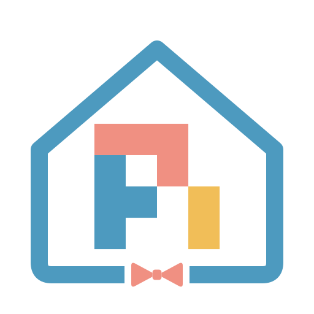

# Pi Butler



An amd64 Home Assistant app providing Pi Coding Agent and Pi Web, an interactive
terminal, persistent Git workspaces, and policy-controlled Home Assistant tools.

HA installation and Linux container checks have passed. Runtime integration
validation in Home Assistant is ongoing. See [testing and live acceptance](docs/TESTING.md).

Add `https://github.com/stieglma/ha-pi-butler` as a repository in Home Assistant's
app store, install Pi Butler, keep protection mode enabled, and select Open Web UI.
The image builds locally on HA; the initial build downloads the pinned tools and
compiles the terminal dependency. No repository or provider login is needed to
open the UI. Pi Web opens directly, with a persistent Home Assistant access link to separate
permission settings. Changes there save and apply immediately. **Setup & house notes** shows readiness
checks and editable persistent household knowledge. Scratch/repository projects
register automatically when ready.
Use an HA administrator account: Pi Butler is one shared privileged
workspace, not a separate workspace per HA user.

Configure a model provider using Pi Web's existing settings/login flow. Configure
Git and gh/glab from its terminal. Read [the setup guide](pi_butler/DOCS.md) for
options, write grants, terminal authentication, delivery and recovery.

The image also bundles structured questions, Powerline footer, dynamic workflows,
subagents and Claude marketplace. See [bundled packages](pi_butler/DOCS.md#bundled-pi-packages)
for versions and activation. The in-repo local marketplace bundles house memory
and read-only automation explanations, incident investigations and health checks.
Use **Investigate your home** to launch these skills with entity/automation pickers
in a new conversation.

The app never shares the live HA configuration directory. Your existing HA Git
app owns deployment. A delivery to its watched branch can cause deployment.

[App documentation](pi_butler/DOCS.md) · [Architecture and scope](docs/ARCHITECTURE.md) ·
[Testing and live acceptance](docs/TESTING.md) · [Changelog](pi_butler/CHANGELOG.md)

## Development

```sh
uv sync --project pi_butler --locked
PYTHONPATH=pi_butler/src uv run --project pi_butler --locked python -m unittest discover -s pi_butler/tests -v
uv run --project pi_butler --locked python pi_butler/tests/check_metadata.py
node --test pi_butler/tests/test_browser_policy.mjs pi_butler/tests/test_starters.mjs
docker build --platform linux/amd64 -t pi-butler:test pi_butler
uv run --project pi_butler --locked bash pi_butler/tests/container_smoke.sh
```

Python dependencies are declared in `pi_butler/pyproject.toml` and locked in
`pi_butler/uv.lock`. Use `uv lock --project pi_butler` after dependency changes;
CI and Docker require the lockfile to stay current. uv manages dependencies at
build time; app processes use the installed Python environment directly.

The add-on release version lives in `pi_butler/config.yaml`. Do not bump the npm
manifest/lock or the Python dependency project's fixed `0.0.0` version for app
releases: those files are Docker dependency-cache inputs. Default extension
registration lives in `pi_butler/bundled-packages.json`, copied after dependency
installation. Change dependency manifests and regenerate locks only when their
inputs change. See [testing](docs/TESTING.md) for image/plugin checks and remaining
live acceptance work.

The Docker smoke check uses a disposable data directory and placeholder upstream
credential. It tests startup, privilege boundaries and shutdown without contacting
HA. It does not replace protected-mode testing under Supervisor.
